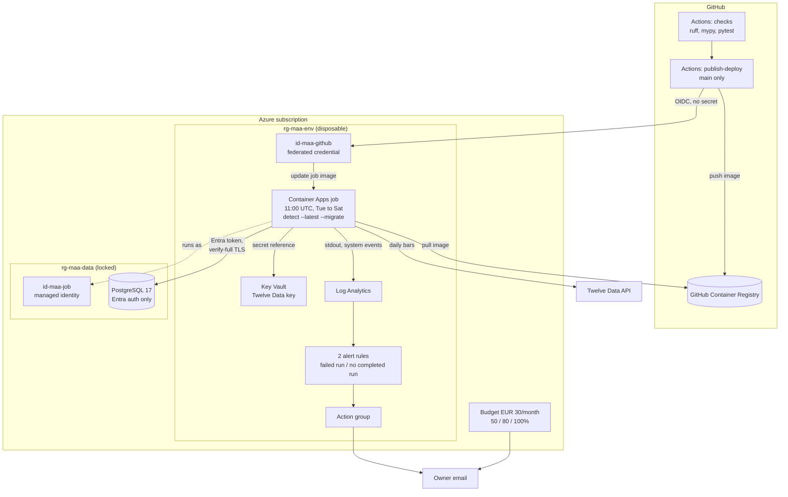

# Market Anomaly Agent

> **Experimental research project, not investment advice.**

A one-person research project that flags, before each US market open, the Nasdaq-100 stocks whose
previous-day move was statistically unusual relative to the market. It demonstrates
market-model anomaly detection in Python, run unattended as an Azure Container Apps job that is
defined entirely in Bicep and deployed by GitHub Actions through OIDC, with no stored passwords.
The job signs in to PostgreSQL with Microsoft Entra tokens only, over `verify-full` TLS, and is covered by
log alerts and a monthly budget. Every feature is built spec-first with
[Spec Kit](https://github.com/github/spec-kit), with tests written before the code.

## What it does

The detection step (feature 001):

- a frozen Nasdaq-100 universe;
- daily split- and dividend-adjusted bars for each stock and for the benchmark (QQQ);
- a market-model abnormal return and z-score per stock over a trailing window of up to 120
  trading days;
- flagging stocks with |z| ≥ 2, at most 10 per day;
- a volume ratio for each flagged case.

Results are stored append-only in PostgreSQL, so a re-run for the same day reproduces the stored
result. If the price data has changed since the first run, the re-run is rejected.

Gathering evidence, the LLM agent, trading signals and the public website are later features.

## Architecture



`rg-maa-env` can be deleted and rebuilt from the repository at any time. `rg-maa-data` holds the
database and the job's identity, carries a delete lock and survives every rebuild.

## Status and roadmap

| Feature | Status |
|---|---|
| [001](specs/001-nasdaq100-anomaly-detection/spec.md) Nasdaq-100 anomaly detection (CLI, PostgreSQL) | Done |
| [002](specs/002-azure-daily-run/spec.md) Unattended daily run on Azure | Done: running unattended on schedule (the optional decommission-and-restore check was not run) |
| 003 An agent that explains flagged anomalies with web search | Next |
| 004 A public website | Later, and only once the data vendor permits public display (see [Data](#data)) |

## Getting started

Setup, configuration and the validation scenarios are in
[`specs/001-nasdaq100-anomaly-detection/quickstart.md`](specs/001-nasdaq100-anomaly-detection/quickstart.md).
The CLI has two modes:

```bash
uv run detect --date 2026-11-10    # evaluate the given trading day
uv run detect --latest             # evaluate the most recent completed trading day (New York time);
                                   # exits 0 without fetching if that day is already stored
uv run detect --latest --migrate   # apply pending database migrations first (either mode)
```

The arguments, output and exit codes are in the CLI contracts of
[feature 001](specs/001-nasdaq100-anomaly-detection/contracts/cli-contract.md) and
[feature 002](specs/002-azure-daily-run/contracts/cli-contract.md), which adds `--latest` and
`--migrate`. The full specifications are in
[001 `spec.md`](specs/001-nasdaq100-anomaly-detection/spec.md) and
[002 `spec.md`](specs/002-azure-daily-run/spec.md).

## Azure daily run

Feature 002 runs the detection unattended on Azure, in France Central:

- **When:** an Azure Container Apps scheduled job starts at **11:00 UTC, Tuesday to Saturday**,
  after every US close and before every US open. It runs `detect --latest --migrate`, which
  evaluates the most recent completed NASDAQ trading day. If that day is already stored (a
  repeated start, or the morning after a holiday) it exits without fetching or writing anything.
- **Where:** the image comes from GitHub Container Registry and is published by GitHub Actions on
  every merge to `main`, which signs in to Azure with OIDC. Results go to Azure Database for
  PostgreSQL (Burstable B1ms, PostgreSQL 17) in its own locked resource group. The Twelve Data key
  is in Key Vault. Logs go to Log Analytics, and a failed run or a missing run sends an email.
- **Retries:** at most 3 attempts per start, within a one-hour limit.

Entry points, all in `infra/scripts/`, with the procedures in
[`specs/002-azure-daily-run/quickstart.md`](specs/002-azure-daily-run/quickstart.md) and the
guarantees in
[`contracts/deployment-contract.md`](specs/002-azure-daily-run/contracts/deployment-contract.md):

| Task | Script |
|---|---|
| Check a region and the subscription | `preflight.sh <region>` |
| Deploy or converge (always behind a what-if) | `deploy.sh` |
| Create the database role and grants (new server only) | `db-access.sh open`, `db-bootstrap.sh`, `db-access.sh close` |
| Query the database as the owner | `db-access.sh open`, then the owner query in the contract, then `db-access.sh close` |
| Delete and rebuild the environment (the database stays) | `teardown.sh`, then `deploy.sh` |
| Export, then delete everything | `decommission.sh <dump path outside the repository>` |
| Bring an export back | `deploy.sh`, `db-bootstrap.sh`, `restore.sh <dump path>` |

**Every `az`, `gh`, `podman` and deployment command runs on the owner's host only**, never inside a
container or in the agent's environment. The repository is public, so the scripts read tenant,
subscription and object IDs, the alert address and the key at run time and never write them to a
file.

**Cost.** The cap is EUR 30 per month, enforced as an Azure budget that emails at 50%, 80% and
100% of the actual cost. Azure budgets only send notifications; they do not stop spending.
Estimate for France Central (research R10, check Q2):

| Item | EUR / month |
|---|---|
| PostgreSQL Flexible Server, Burstable B1ms, 730 h, 32 GiB storage | about 16.30 |
| Two log alert rules (estimate) | about 1.79 |
| Container Apps job and environment, Log Analytics, Key Vault | within the free grants, or a few cents |
| Container registry (GitHub Container Registry, public package) | 0 |
| **Total** | **about 18**, against the EUR 30 cap |

## Lessons learned

Real problems found during the first deployment and operation of feature 002, with their causes
and fixes. Details are in the linked task or research entry.

| Problem | Cause | Fix |
|---|---|---|
| Several EU regions refused the database server | Some EU regions were restricted for this subscription, closed to new customers, or had no B1ms capacity, although the SKU listing passed | Probed by actually creating a server; moved to France Central ([T027](specs/002-azure-daily-run/tasks.md), [R2](specs/002-azure-daily-run/research.md#r2-region-france-central)) |
| `deploy.sh` read empty deployment outputs | `az deployment sub show` returned `AZURE_CLIENT_ID` as `azurE_CLIENT_ID`, so the exact-name query matched nothing | Look up output names case-insensitively with `jq`; refuse empty values ([T025](specs/002-azure-daily-run/tasks.md)) |
| Opening the database firewall failed with "unrecognized arguments" | The Azure CLI renamed the `firewall-rule` flags (`--rule-name` is gone; `-n` now means the rule) | Use the long forms `--server-name` and `--name`, checked with `--help` ([T021](specs/002-azure-daily-run/tasks.md)) |
| `psql` failed with "certificate verify failed" | The `postgres:17` client image has no CA bundle, so `verify-full` had no trusted roots | Mount the host's CA bundle read-only into the client container ([T023](specs/002-azure-daily-run/tasks.md), [R8](specs/002-azure-daily-run/research.md#r8-tls-to-the-database)) |
| `azure/login` failed with `AADSTS700213` | GitHub now issues immutable OIDC subjects that contain the numeric owner and repository IDs | Build the federated credential's subject from those IDs, read at deploy time ([T019](specs/002-azure-daily-run/tasks.md), [R7](specs/002-azure-daily-run/research.md#r7-github-actions-checks-oidc-and-deployment)) |
| Tenant, subscription and client IDs appeared in public Actions logs | `azure/login` prints its inputs, and repository variables are not masked | Move the three values to repository secrets; gate the deploy job on a non-sensitive variable ([T026](specs/002-azure-daily-run/tasks.md), [R7](specs/002-azure-daily-run/research.md#r7-github-actions-checks-oidc-and-deployment)) |
| A failed image lookup would have rolled the job back to the placeholder | `2>/dev/null \|\| true` turned any error into "no job yet" | Decide explicitly whether the job exists; any other failure stops before the what-if ([T025](specs/002-azure-daily-run/tasks.md)) |
| `computed_at` was set before the 14-minute fetch | The CLI took the time once, before fetching, against feature 001's FR-014 | Inject a clock and read it after the last fetch; tests written red first ([T055](specs/002-azure-daily-run/tasks.md)) |
| A repeated start re-fetched all 101 series (about 14 minutes and 101 vendor credits) | The scheduled mode had no "already stored" check | `--latest` exits 0 without fetching when the day is stored; a repeat now takes under a minute ([T032, T033](specs/002-azure-daily-run/tasks.md)) |
| Unclear whether the job timeout applies per attempt or per execution | The documentation is ambiguous | Measured with a disposable job copy (check Q3): per execution, so 3600 s stays ([T037](specs/002-azure-daily-run/tasks.md), [R1](specs/002-azure-daily-run/research.md#r1-job-time-limit-per-attempt-or-per-execution)) |
| One failed run sent two alert emails | A 10-minute window evaluated every 5 minutes saw the same rows twice | Match only execution-level reasons, one row per execution, mute actions for 1 hour ([T039](specs/002-azure-daily-run/tasks.md), [R9](specs/002-azure-daily-run/research.md#r9-failure-alerting)) |
| The alerts' resource provider was missing | `Microsoft.Insights` was not registered in the subscription | Registered it; `preflight.sh` now checks every provider the feature needs ([T039](specs/002-azure-daily-run/tasks.md), [R9](specs/002-azure-daily-run/research.md#r9-failure-alerting)) |
| Logs were still there after a teardown and rebuild | Recreating a Log Analytics workspace under the same name within its soft-delete period recovers it with its data | Documentation corrected; the teardown time guard kept for its other reason ([T045](specs/002-azure-daily-run/tasks.md), [R9](specs/002-azure-daily-run/research.md#r9-failure-alerting)) |
| An alert rule failed with "The workspace could not be found" on rebuild | The alerts service did not yet see the just-created workspace | Rerun `deploy.sh`; documented in the rebuild procedure ([T045](specs/002-azure-daily-run/tasks.md), [R9](specs/002-azure-daily-run/research.md#r9-failure-alerting)) |
| The "already stored" log line of the first start after a rebuild never arrived | The console output of that very short execution (2 s) never reached Log Analytics; its system logs did | Confirm that start through its system logs (container runtime, exit code 0) and the unchanged `detection_runs` ([T045](specs/002-azure-daily-run/tasks.md), [quickstart §4](specs/002-azure-daily-run/quickstart.md)) |
| Per-attempt failure reasons differed between failures (`Error` in one test, `ContainerTerminated` and `ProcessExited` in another) | The platform's per-replica reasons are not stable or documented | Alert only on the execution-level reasons `BackoffLimitExceeded` and `DeadlineExceeded`, confirmed by the bad-key test ([T040](specs/002-azure-daily-run/tasks.md), [R9](specs/002-azure-daily-run/research.md#r9-failure-alerting)) |
| A one-off start with a different date needs every setting repeated | Overriding a job start replaces the whole container definition, including its environment variables | The backfill procedure passes the image, resources and all environment variables, read from the job definition; the identity is kept ([T040](specs/002-azure-daily-run/tasks.md), [quickstart §4](specs/002-azure-daily-run/quickstart.md)) |

## Known limitations

- **The benchmark contains the evaluated stocks.** QQQ tracks the Nasdaq-100, so every evaluated
  stock is part of its own benchmark. Part of a large stock's move is already in the benchmark
  return it is compared against, so abnormal returns of the largest constituents are slightly
  understated.
- **No prediction-error correction in the z-score.** The z-score divides the abnormal return by
  the residual standard deviation of the estimation window. The event-study variance of the
  prediction error is not used: it would add the out-of-sample uncertainty of the fitted alpha
  and beta (MacKinlay 1997, "Event Studies in Economics and Finance"). This is a deliberate
  simplification. With 60–120 estimation days the correction is small, and it would slightly
  shrink every z-score.
- **Renamed or delisted tickers are not followed.** The universe is frozen at its snapshot date.
  A constituent that is later renamed or delisted is not replaced. On days with no data for it,
  the stock is recorded as a `missing_data` skip.

## Data

Price data comes from the Twelve Data free Basic plan. It is used for internal computation only.
Showing the data, or results derived from it, publicly is blocked until Twelve Data grants written
permission (see
[research.md §1](specs/001-nasdaq100-anomaly-detection/research.md)). This repository therefore
contains no prices, returns or run results. The tests use synthetic data.

## License

The code is released under the [MIT License](LICENSE). The license covers the code only. The
repository contains no market data: prices from Twelve Data stay subject to the vendor's terms
(see [Data](#data)).
